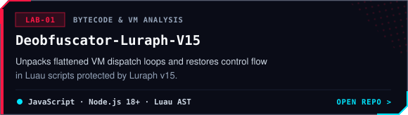
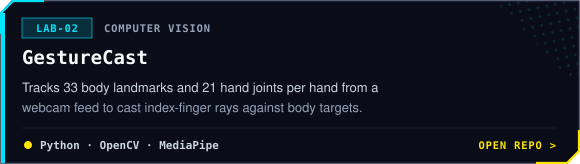
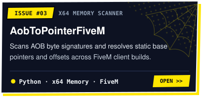

  

  &nbsp;&nbsp;&nbsp;&nbsp;

  

  &nbsp;

  

  &nbsp;

  &nbsp;

  

  

  

  <picture>
    <source media="(prefers-color-scheme: dark)" srcset="https://raw.githubusercontent.com/xDTaraZz/xDTaraZz/output/spider-snake-dark.svg"/>
    <source media="(prefers-color-scheme: light)" srcset="https://raw.githubusercontent.com/xDTaraZz/xDTaraZz/output/spider-snake-light.svg"/>
    
  </picture>

  

