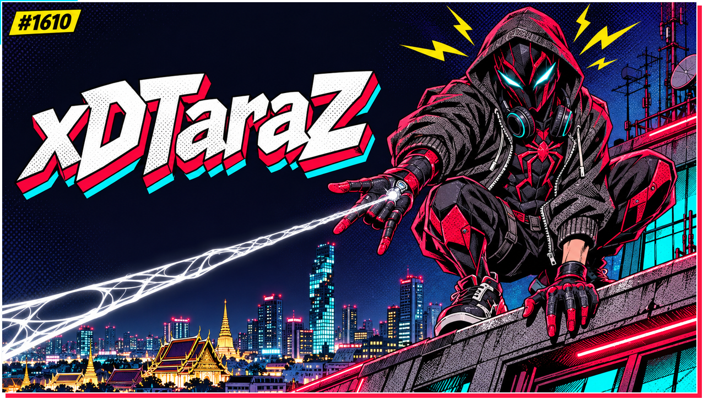
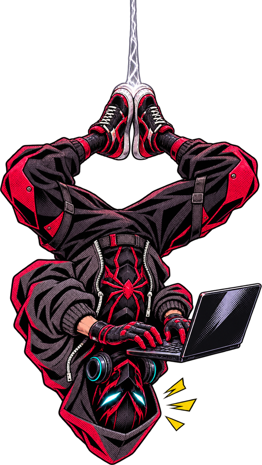
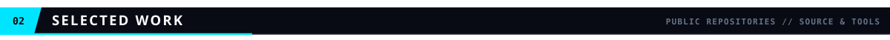
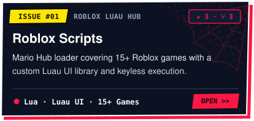
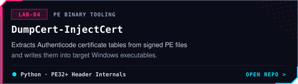
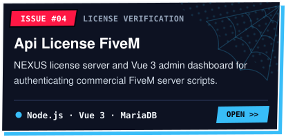
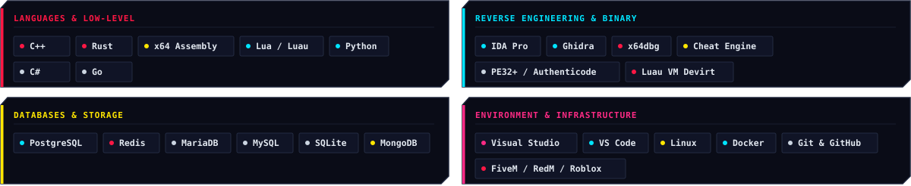

  

  &nbsp;&nbsp;

  

### Hey, I'm Tara (`#1610`)

I'm a 17-year-old freelance developer in Bangkok with 6+ years writing code close to memory and bytecode.

Most days I reverse engineer Windows x64 binaries in IDA Pro and x64dbg, unpack virtualized Luau scripts, or write native utilities in C++, Rust, C#, Go, and Python. On the multiplayer side, I build custom server frameworks, license verification APIs, and anti-glitch mechanics for FiveM, RedM, and Roblox.

Based in Bangkok, Thailand (`13.7563° N, 100.5018° E` · `UTC+07:00`) · Full interactive hub at [xdtaraz.com](https://xdtaraz.com)

 

  

  &nbsp;

  &nbsp;

  

  

  

  <picture>
    <source media="(prefers-color-scheme: dark)" srcset="https://raw.githubusercontent.com/xDTaraZz/xDTaraZz/output/spider-snake-dark.svg"/>
    <source media="(prefers-color-scheme: light)" srcset="https://raw.githubusercontent.com/xDTaraZz/xDTaraZz/output/spider-snake-light.svg"/>
    
  </picture>

  

